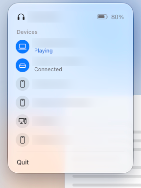

# Bose Switcher

A macOS menu bar app for switching the devices connected to Bose QuietComfort Ultra Headphones (2nd Gen). See the battery level, check which device is playing, and connect or disconnect a paired device.



Device names are blurred for privacy.

## Requirements

- A Mac running macOS 27 or later. Earlier versions are not supported.
- Xcode Command Line Tools with the macOS 27 SDK or later.
- Bose QuietComfort Ultra Headphones (2nd Gen), paired with the Mac. Other models are untested.
- The devices you want to switch between must already be paired with the headphones.

The app uses SwiftUI, AppKit and Apple's Bluetooth frameworks. No third-party packages or account are needed.

## Install from source

Download or clone this repository, then open Terminal in its folder. If you need the command line tools, install them with `xcode-select --install`. Check that `xcrun --show-sdk-version` reports 27 or later.

Quit any running copy of Bose Switcher, then run:

```sh
./build.sh
open "$HOME/Applications/Bose Switcher.app"
```

The script builds for your Mac's architecture, applies a local ad-hoc signature, and installs into `~/Applications`. It replaces any existing copy. To update, download the new source and repeat these steps. This is a local build, not an Apple-notarized download.

## First run

1. Allow Bluetooth access when macOS asks. If you denied it, enable Bose Switcher in **System Settings → Privacy & Security → Bluetooth**, then reopen the app.
2. Connect the headphones to the Mac in **System Settings → Bluetooth** once to load their paired devices.
3. Click the headphones-and-arrows menu bar icon. Click a connected device to disconnect it, or another device to connect it.

Blue icons mark connected devices. The row shows **Playing**, **Connected**, or progress while a switch is pending. This Mac appears first. The panel stays open during a switch; press Escape or click outside to close it.

## How it works

The app talks directly to the headphones using Bose's private BMAP protocol over Bluetooth RFCOMM channel 2. Bluetooth work runs on a separate thread, with clicks taking priority over refreshes. Paired-device scans stop after three seconds or when interrupted by a queued action. The panel refreshes connection states every two seconds while open.

Device names and addresses are cached in local app preferences. There is no cloud service or telemetry. When the Mac is disconnected, the panel shows cached devices without live connection states or battery. Clicking a device can temporarily connect the Mac to send the command, then disconnect it again. Quitting allows up to 1.5 seconds to release that temporary connection.

## Limits

- The headphones allow two active connections. Connecting a third can drop the device that is not playing, including when the Mac connects temporarily.
- Switching can take several seconds or time out. Wear the headphones when connecting devices; they may refuse connections while off-head.
- The protocol is undocumented and firmware changes may break it. Compatibility with other headphones is not guaranteed.
- The app controls one pair of headphones. It selects the first paired device advertising the BMAP service and remembers it; there is no headphone picker.
- Only one app on the Mac can use the control channel at a time. Quit Bose Switcher before using `bosectl`.

## Troubleshooting

| Problem | What to try |
| --- | --- |
| Build fails | Check `xcrun --show-sdk-version`. Install or select command line tools with the macOS 27 SDK or later. |
| Bluetooth access is blocked | Enable the app under **Privacy & Security → Bluetooth**. Rebuilding changes its signature, so macOS may ask again. |
| No devices appear | Pair and connect the headphones to this Mac in Bluetooth settings, then reopen the panel. |
| “Not connected to this Mac” | Connect the Mac in Bluetooth settings to restore live states and battery. Cached rows can still send commands. |
| “Couldn't connect” or “No answer” | Check that the target is nearby, Bluetooth is on, and the headphones are worn. Quit other BMAP clients before trying again. |

## Development

```sh
bash Tests/check.sh
```

This compiles the app, runs behavior checks with fake Bluetooth devices, validates the plist and build script, and removes its temporary files. It does not install or launch the app or use Bluetooth hardware. See [CONTRIBUTING.md](CONTRIBUTING.md) for hardware testing and bug reports.

## Credits and license

Protocol research by [bosectl](https://github.com/aaronsb/bosectl) made this app possible.

Released under the [MIT License](LICENSE).

Bose Switcher is not affiliated with or endorsed by Bose Corporation. Bose and QuietComfort are trademarks of Bose Corporation.
